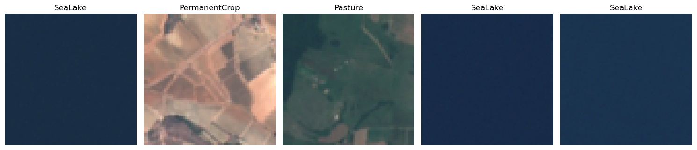
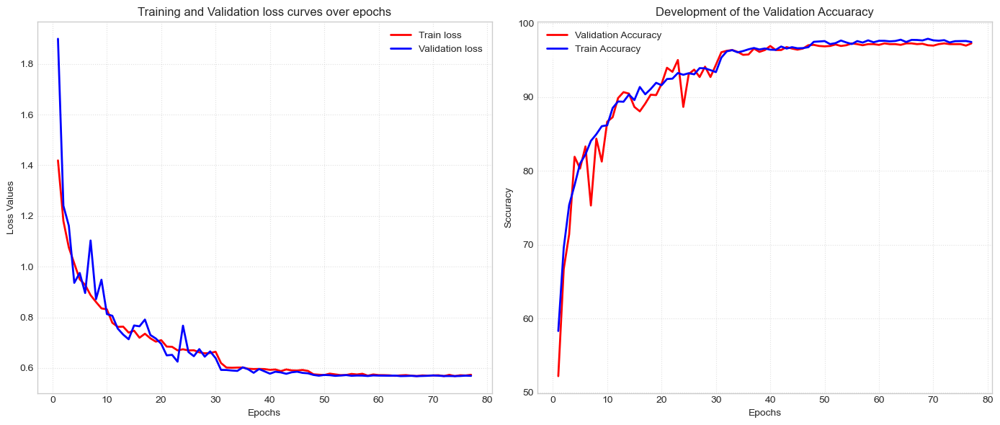
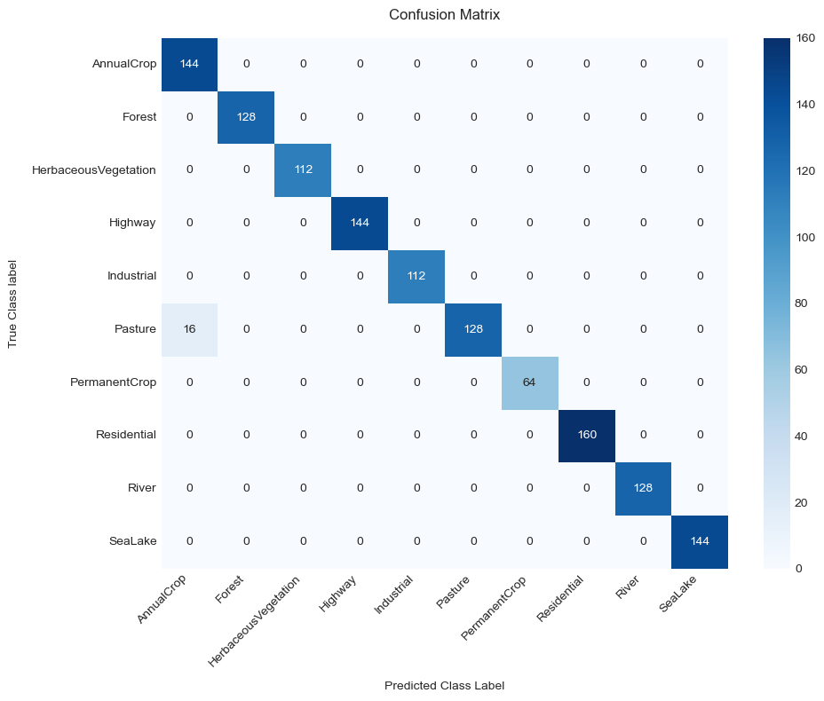
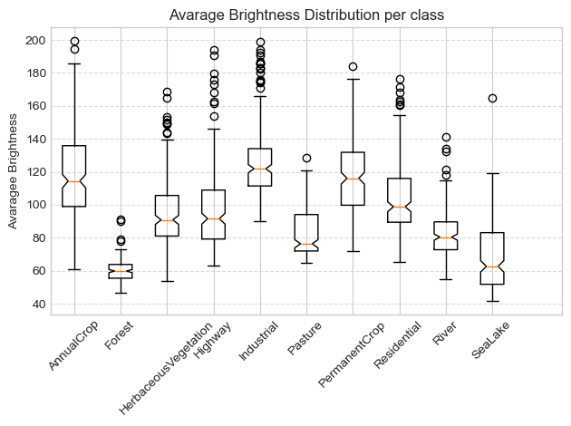
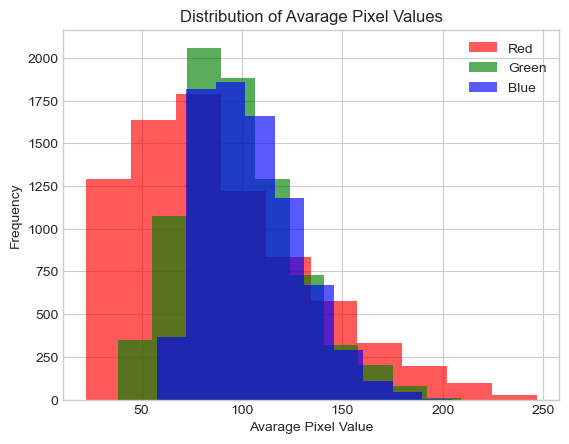

<div align="center">

# 🛰️ EuroSAT Satellite Land Cover Classification

[](https://www.python.org/)
[](https://pytorch.org/)
[](https://streamlit.io/)
[](https://www.docker.com/)
[](https://github.com)
[](LICENSE)

*High-accuracy deep convolutional neural network for Land Use and Land Cover (LULC) classification using European Space Agency Sentinel-2 satellite imagery.*

[Live Web Demo](#-interactive-web-application) • [Architecture](#-model-architecture) • [Quickstart](#-quickstart-guide) • [Docker](#-docker-deployment) • [CLI Inference](#-cli-inference) • [Results](#-benchmarks--evaluation)

</div>

---

## 📌 Project Overview

This project implements an end-to-end Computer Vision system for automated Earth Observation and Remote Sensing. Utilizing optical imagery from the **EuroSAT Sentinel-2 satellite dataset**, a custom 8-layer deep convolutional neural network (**`SateliteCNN`**) classifies surface patches into 10 distinct land cover categories with **97.15% test accuracy**.

### Key Highlights
- **Custom Deep CNN (`SateliteCNN`)**: 4 dual-convolution blocks (8 Conv layers), Batch Normalization, Dropout regularization, and Adaptive Average Pooling.
- **Interactive Web App**: Built with **Streamlit** for real-time inference, sample image preview, and confidence distribution charts.
- **Production-Ready Dockerization**: Lightweight CPU-optimized container with multi-stage build, health checks, and `docker-compose`.
- **Modular Codebase**: Clean separation of model definitions (`src/model.py`), data loading (`src/dataset.py`), CLI inference (`src/predict.py`), and training (`src/train.py`).
- **Comprehensive Unit Tests**: Built-in test suite covering tensor dimensions, parameter counts, weights loading, and transforms.
- **CI/CD Automation**: GitHub Actions workflow testing Python 3.10/3.11 and Docker builds.

---

## 🖼️ Dataset: EuroSAT Sentinel-2

The **EuroSAT** benchmark contains 27,000 georeferenced satellite patches (64×64 pixels) acquired by the ESA Sentinel-2 satellite across 34 European countries.

<div align="center">
  
  <p><em>Figure 1: Representative Sentinel-2 RGB satellite patches across land cover categories.</em></p>
</div>

### 10 Land Cover Classes

| # | Class Name | Description |
|:--:|:---|:---|
| 0 | **AnnualCrop** | Regularly cultivated agricultural land with annual crops (cereals, vegetables). |
| 1 | **Forest** | Dense natural woodland and forested canopy areas. |
| 2 | **HerbaceousVegetation** | Natural grasslands, meadows, and wild low vegetation cover. |
| 3 | **Highway** | Paved major transport corridors, motorways, and infrastructure lines. |
| 4 | **Industrial** | Commercial complexes, manufacturing plants, logistics hubs, and large buildings. |
| 5 | **Pasture** | Managed grazing meadows and livestock agricultural grassland. |
| 6 | **PermanentCrop** | Long-term plantations including orchards, olive groves, and vineyards. |
| 7 | **Residential** | Urban and suburban settlements, houses, apartment blocks, and city centers. |
| 8 | **River** | Inland flowing water bodies, river channels, and canals. |
| 9 | **SeaLake** | Open coastal waters, inland lakes, reservoirs, and natural marine basins. |

---

## 🏗️ Model Architecture

The `SateliteCNN` architecture was specifically designed for high-resolution feature extraction from compact 64×64 satellite image patches:

```
Input: (3, 64, 64)
  │
  ├── Block 1: Conv2d(3->32)  -> BatchNorm -> ReLU -> Conv2d(32->32)  -> BatchNorm -> ReLU -> MaxPool2d(2x2) [32, 32, 32]
  ├── Block 2: Conv2d(32->64) -> BatchNorm -> ReLU -> Conv2d(64->64)  -> BatchNorm -> ReLU -> MaxPool2d(2x2) [64, 16, 16]
  ├── Block 3: Conv2d(64->128)-> BatchNorm -> ReLU -> Conv2d(128->128)-> BatchNorm -> ReLU -> MaxPool2d(2x2) -> Dropout2d(0.1) [128, 8, 8]
  ├── Block 4: Conv2d(128->256)->BatchNorm -> ReLU -> Conv2d(256->256)->BatchNorm -> ReLU -> Dropout2d(0.2) [256, 8, 8]
  │
  ├── AdaptiveAvgPool2d((2, 2)) -> Flatten (256 * 2 * 2 = 1,024 features)
  ├── Linear(1024 -> 512) -> BatchNorm1d -> ReLU -> Dropout(0.3)
  └── Linear(512 -> 10) -> Class Logits
```

- **Total Trainable Parameters**: `~1,682,000`
- **Regularization**: Batch Normalization after every Conv layer, 2D Spatial Dropout (0.1, 0.2), Dense Dropout (0.3), and Label Smoothing (0.1).
- **Optimization**: AdamW (`lr=0.001`, `weight_decay=1e-4`), `ReduceLROnPlateau` scheduler, and Early Stopping.

---

## 📊 Benchmarks & Evaluation

<div align="center">
  <table>
    <tr>
      <td align="center"><b>Training & Validation Dynamics</b></td>
      <td align="center"><b>Confusion Matrix (Validation Set)</b></td>
    </tr>
    <tr>
      <td></td>
      <td></td>
    </tr>
    <tr>
      <td align="center"><b>Average Brightness by Class</b></td>
      <td align="center"><b>Spectral Pixel Distribution</b></td>
    </tr>
    <tr>
      <td></td>
      <td></td>
    </tr>
  </table>
</div>

- **Peak Validation Accuracy**: **`97.15%`**
- **Validation Loss**: `0.7208` (Cross-Entropy with label smoothing)
- Strong diagonal dominance in the confusion matrix demonstrates robust discrimination between visually similar categories (e.g., AnnualCrop vs. PermanentCrop vs. Pasture).

---

## 🚀 Quickstart Guide

### 1. Clone the Repository
```bash
git clone https://github.com/your-username/eurosat-satellite-classification.git
cd eurosat-satellite-classification
```

### 2. Environment Setup

#### Option A: Using Conda
```bash
conda env create -f environment.yml
conda activate eurosat-cnn
```

#### Option B: Using Python `venv` & `pip`
```bash
python -m venv .venv
# On Windows:
.venv\Scripts\activate
# On Linux/macOS:
source .venv/bin/activate

pip install -r requirements.txt
```

---

## 🐳 Docker Deployment

The application is fully containerized using an optimized, lightweight CPU PyTorch image (~600MB).

### Single-Command Start with Docker Compose
```bash
docker compose up --build
```
Open your browser and navigate to **`http://localhost:8501`**.

### Standard Docker Build & Run
```bash
# Build the Docker image
docker build -t eurosat-classifier:latest .

# Run the container
docker run -p 8501:8501 eurosat-classifier:latest
```

---

## 💻 Interactive Web Application

Launch the Streamlit interactive dashboard locally:
```bash
streamlit run app/app.py
```

### Features
- **Live Image Upload**: Drag & drop any satellite patch (.jpg, .png).
- **1-Click Sample Testing**: Instant testing with pre-loaded representative images from all 10 classes (`samples/`).
- **Confidence Visualizer**: Top-k probability distribution bar chart.
- **Model Insights Tab**: Interactive access to training curves, confusion matrix, and spectral brightness metrics.

---

## ⚡ CLI Inference

Classify satellite images directly from your terminal using `src/predict.py`:

```bash
# Predict a single image
python -m src.predict --image samples/Forest.jpg

# Predict top-5 classes with confidence bars
python -m src.predict --image samples/Highway.jpg --top-k 5

# Predict all images in a folder
python -m src.predict --image samples/

# Output structured JSON (ideal for API integrations or scripts)
python -m src.predict --image samples/SeaLake.jpg --json
```

**Example Output:**
```
=================================================================
 EuroSAT Satellite Land Cover Classification Results
=================================================================

Image: Forest.jpg
--> Predicted: Forest (92.46%)
    Top Candidates:
    [1] Forest                  92.46%  ##################
    [2] HerbaceousVegetation     1.07%  
    [3] Residential              0.94%  

=================================================================
```

---

## 🏋️ Training from Scratch

To retrain the model on the full EuroSAT dataset:

```bash
python -m src.train --data-dir data --epochs 25 --batch-size 32 --lr 0.001
```

### Command-Line Arguments
| Flag | Default | Description |
|:---|:---|:---|
| `--data-dir` | `data` | Path to directory containing class subfolders |
| `--epochs` | `25` | Maximum training epochs |
| `--batch-size` | `32` | DataLoader batch size |
| `--lr` | `0.001` | Adam initial learning rate |
| `--patience` | `4` | Early stopping epoch patience |
| `--save-path` | `app/satellite_model.pth` | Target weights checkpoint path |
| `--device` | `auto` | Computing device (`auto`, `cpu`, `cuda`, `mps`) |

---

## 🧪 Unit Testing

Run the automated test suite (works with both `unittest` and `pytest`):

```bash
# Using standard Python unittest (no extra dependencies required)
python -m unittest tests/test_model.py -v

# Or using pytest
pytest tests/ -v
```

All 6 test cases verify:
1. `test_model_forward_pass_dimensions`: Validates tensor output `(B, 10)`.
2. `test_model_parameter_count`: Checks parameter budget (~1.7M params).
3. `test_checkpoint_loading`: Verifies weight compatibility with `satellite_model_9715.pth`.
4. `test_transforms_pipeline`: Validates 64×64 normalization transforms.
5. `test_predict_sample_forest`: End-to-end inference accuracy check.
6. `test_all_classes_mapped`: Verifies all 10 EuroSAT classes.

---

## 📥 Downloading the EuroSAT Dataset

Due to GitHub's repository limits, the full 10,000-image dataset is excluded via `.gitignore`. Curated sample images for testing are included in `samples/`.

To train from scratch or evaluate on the complete dataset:
1. Download the **EuroSAT RGB** dataset from [Zenodo](https://zenodo.org/record/7768375) or [TensorFlow Datasets](https://www.tensorflow.org/datasets/catalog/eurosat).
2. Extract the archive into the `data/` folder:
   ```
   CNN_projekt/
   └── data/
       ├── AnnualCrop/
       ├── Forest/
       ├── HerbaceousVegetation/
       ├── ...
       └── SeaLake/
   ```

---

## 📁 Repository Structure

```
CNN_projekt/
├── .github/
│   └── workflows/
│       └── ci.yml               # Automated CI (Python 3.10/3.11 tests + Docker build)
├── app/
│   ├── app.py                   # Streamlit interactive web application
│   ├── satellite_model_9715.pth # Trained weights (6.8 MB, 97.15% accuracy)
│   └── submission.csv           # Test set prediction benchmark
├── assets/                      # Evaluation plots (curves, confusion matrix, EDA)
│   ├── brightness_per_class.png
│   ├── confusion_matrix.png
│   ├── pixel_distribution.png
│   ├── random_samples.png
│   └── training_curves.png
├── samples/                     # 10 curated sample images (1 per class) for quick testing
│   ├── AnnualCrop.jpg
│   ├── Forest.jpg
│   ├── HerbaceousVegetation.jpg
│   ├── Highway.jpg
│   ├── Industrial.jpg
│   ├── Pasture.jpg
│   ├── PermanentCrop.jpg
│   ├── Residential.jpg
│   ├── River.jpg
│   └── SeaLake.jpg
├── src/                         # Reusable Python source package
│   ├── __init__.py
│   ├── dataset.py               # Data loaders, augmentation pipelines, preprocessing
│   ├── model.py                 # SateliteCNN architecture & model loading
│   ├── predict.py               # CLI inference utility (single image, batch, JSON)
│   └── train.py                 # Standalone training script with early stopping
├── tests/                       # Unit test suite
│   ├── __init__.py
│   └── test_model.py
├── .dockerignore                # Docker exclusion rules
├── .gitignore                   # Git exclusion rules (ignores data/, caches, envs)
├── Dockerfile                   # Lean CPU-optimized production Dockerfile
├── docker-compose.yml           # 1-click container orchestration
├── environment.yml              # Conda environment definition
├── K12515096.ipynb              # Sanitized, portable Jupyter notebook
├── LICENSE                      # MIT Open Source License
├── README.md                    # Project documentation
├── requirements.txt             # Production runtime dependencies
└── requirements-dev.txt         # Development & testing dependencies
```

---

## 📤 Pushing to GitHub

To publish this project to your GitHub account:

```bash
# 1. Initialize git (if not already done)
git init

# 2. Stage all prepared files (.gitignore automatically excludes data/)
git add .

# 3. Create your initial commit
git commit -m "feat: initial commit of EuroSAT satellite classification project"

# 4. Set default branch to main
git branch -M main

# 5. Link your GitHub remote repository (replace with your repo URL)
git remote add origin https://github.com/<your-username>/<your-repo-name>.git

# 6. Push to GitHub
git push -u origin main
```

---

## 📜 References & Citations

- **EuroSAT Paper**: Helber, P., Bischke, B., Dengel, A., & Borth, D. (2019). *EuroSAT: A Novel Dataset and Deep Learning Benchmark for Land Use and Land Cover Classification*. IEEE Journal of Selected Topics in Applied Earth Observations and Remote Sensing, 12(7), 2217-2226. [arXiv:1709.00029](https://arxiv.org/abs/1709.00029).
- **Sentinel-2 Mission**: European Space Agency (ESA) Copernicus Programme.

---

## 📄 License

This project is licensed under the [MIT License](LICENSE).
